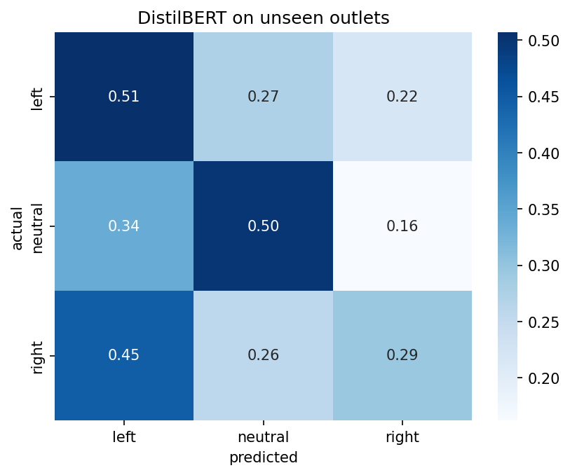

# Media Bias Detection in News Headlines

Classifies a news headline as left-leaning, neutral, or right-leaning.
Built as a training project: SBERT baseline first, then a fine-tuned DistilBERT.

## Data
Kaggle: "News articles for political bias classification" (Pablo Gandia),
scraped from AllSides. About 10.8k headlines after cleaning.
The original 5 labels were merged into 3: left + leaning-left -> left,
right + leaning-right -> right, center -> neutral.

Worth knowing: the label belongs to the news outlet, not to the individual
headline. Plenty of headlines are just plain event reporting, so the labels
are noisy by design.

## What I did
1. Cleaned headlines (links, extra spaces, very short titles, duplicates)
2. EDA: class balance, headline length, words that lean left or right
3. Baseline: SBERT (all-MiniLM-L6-v2) embeddings + Logistic Regression
4. Fine-tuned distilbert-base-uncased with class weights (neutral is only ~14%)

## One problem I ran into
Every outlet in the data belongs to exactly one class, so a model can score
well just by recognising outlet style (Fox-style titles, BBC-style titles).
To check this, I split train/test by outlet, so test headlines come from
outlets the model never saw, and compared it to a normal random split.

## Results (macro F1)
| Model | Unseen outlets | Random split |
|---|---|---|
| SBERT + Logistic Regression | 0.30 | 0.39 |
| DistilBERT (fine-tuned) | 0.35 | 0.46 |

DistilBERT on unseen outlets: accuracy 0.40.

## What I take from this
- Fine-tuning helps over the baseline, but not by a huge amount.
- Scores drop by about 0.10 on unseen outlets, so part of the random-split
  score comes from outlet style rather than real bias signal.
- On new outlets the model leans towards "left" and misses many right headlines.
- Neutral is the weakest class: few examples, and the neutral test set is
  small in the outlet split, so its numbers are noisy.

## Limitations
- Labels come from outlets, not from human judgement of each headline
- Only one run per setup, no seed averaging
- Headlines come from a limited time window, so topics (Gaza, covid) are
  partly tied to the labels
- 3 epochs, no hyperparameter tuning

## Run it
Open the notebook in Google Colab (T4 GPU), upload the Kaggle CSV, run all cells.